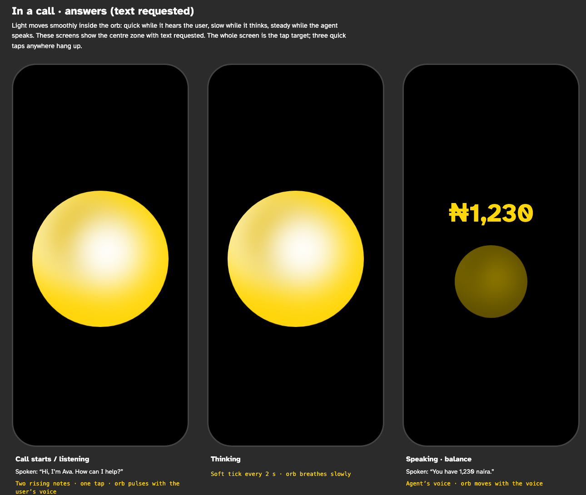
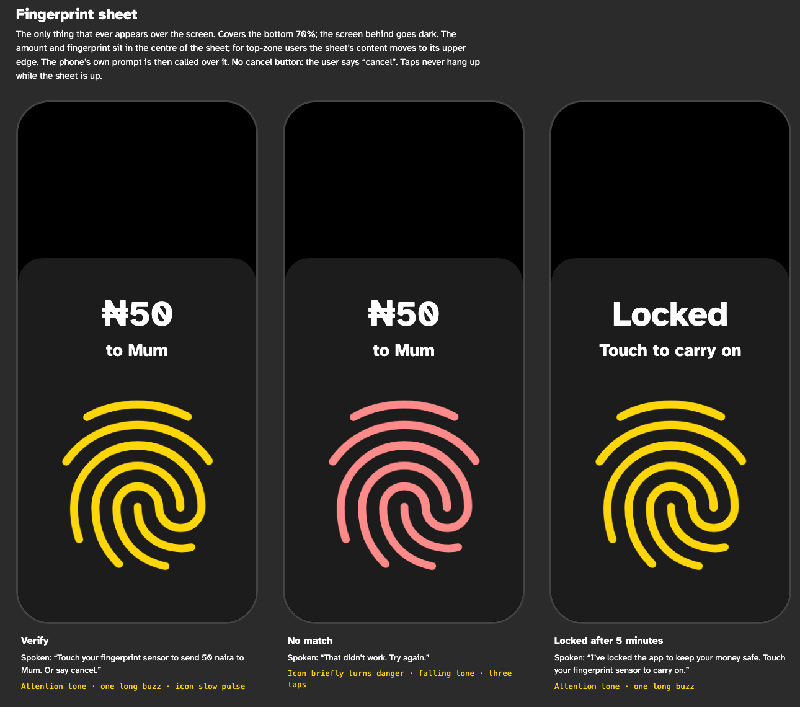
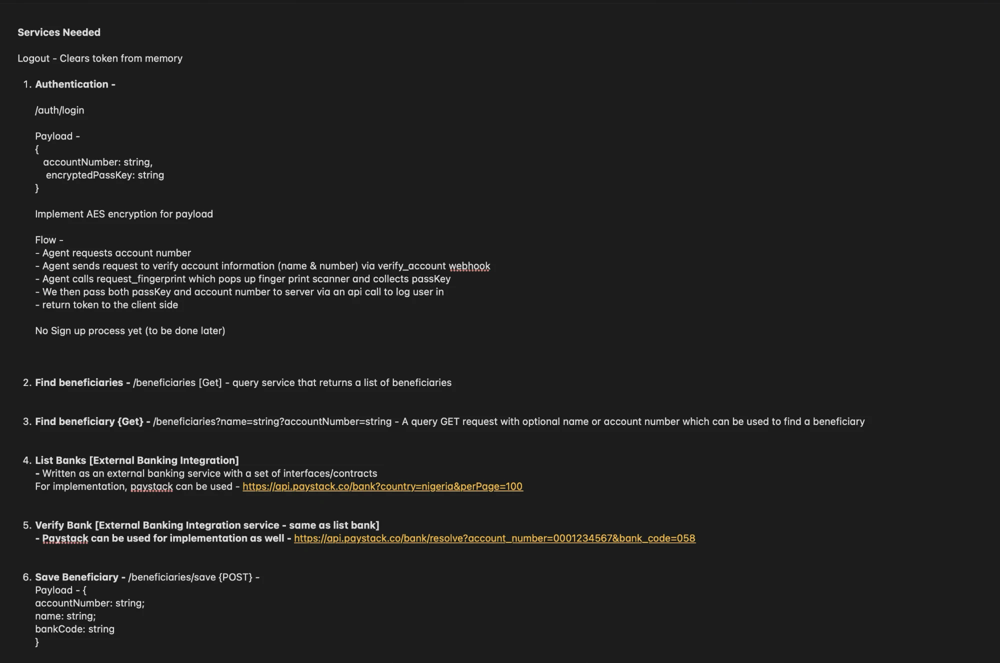
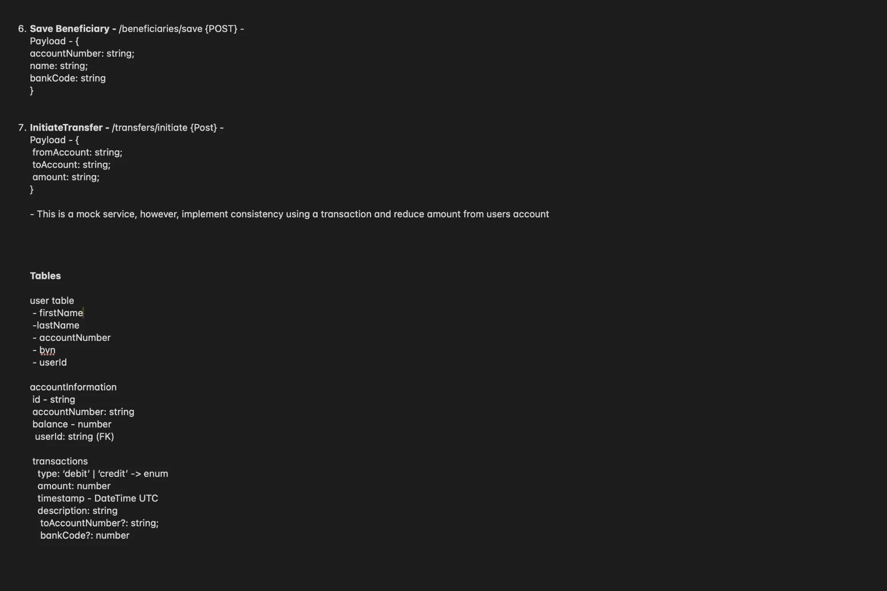

# Responsible use of AI

We designed SoloBanking ourselves and used AI as a supporting tool.

## 1. We designed it first

Before writing any code, we designed the screens and planned the services the app talks to.

Our designs and plan set the rules the app had to follow:

- The voice screen is the main screen. Text is there for anyone who wants it.
- Log in with an account number and a fingerprint, with the passkey encrypted before it leaves the phone.
- Talk to the server only through our own API, with every request grouped by area.
- No sign-up yet.

## 2. AI helped us debug

We found each of these problems ourselves while using the app. We used an AI assistant (Claude Code) to trace the cause, then checked the fix ourselves:

- **The call screen dropped mid-call.** After a failed fingerprint step, the app showed the microphone screen even though the call was still live. The cause was the voice SDK marking the whole session as failed when one tool errored. We now track the call's connection separately.
- **The receipt didn't appear when asked for.** After a payment, asking the agent to show the receipt did nothing. The agent had no way to open it, so we added tools to show and close the receipt.
- **The Text button did nothing.** Switching to the text screen was wrongly tied to being signed in. We made it a plain switch, so one tap changes the view.
- **The app jumped to the text screen after sign-in.** It switched screens on its own after login. We removed that, so the voice screen stays the default until the user taps Text.
